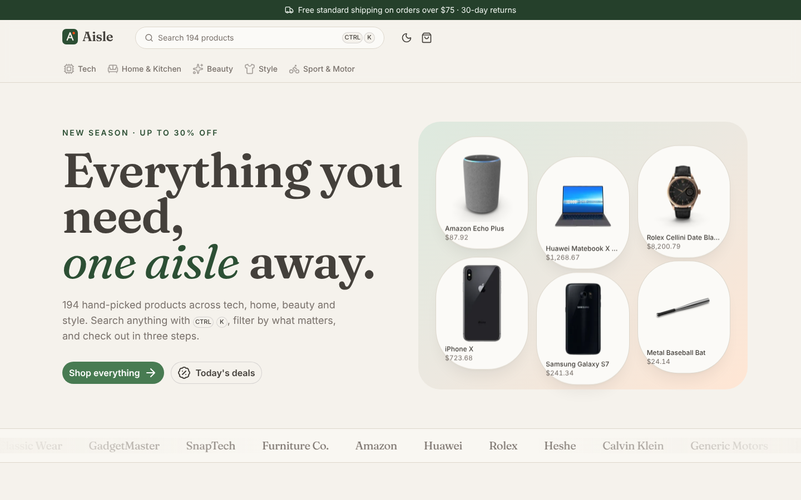

# Aisle

**A fast, friendly online store: faceted search, a ⌘K command palette, a slide-over cart and a server-priced checkout.**

Live: https://aisle-rahul.vercel.app



Aisle started as the Amazon homepage clone I built in plain HTML and CSS while learning front end. This version is a real store in **Nuxt 4 and Vue 3**, with its own brand, ~200 real products, and the parts of a shop that are actually hard: search, filters, a cart that survives a refresh, and a checkout the browser can't cheat.

## Features

- **Faceted search.** Filter by category, brand, price range, rating, "on sale" and "in stock", and sort five ways. Facet counts update with every filter, and each facet ignores its own filter, so picking one brand still shows the others.
- **Everything in the URL.** `/shop?dept=tech&brand=Apple&sort=price-asc&min=100` is a real, shareable page. Back and forward work, and refresh keeps your place.
- **⌘K command palette.** Press `⌘K`, `Ctrl+K` or `/` anywhere for instant, debounced product search with thumbnails and prices.
- **Product pages.** Image gallery with hover-to-zoom, reviews with a rating breakdown, stock warnings, related products, and Product JSON-LD for search engines.
- **Cart.** Slide-over cart with quantity steppers, a free-shipping progress bar and savings, kept in `localStorage` (guarded for private windows).
- **Three-step checkout.** Address form validated with Zod, delivery speed, then review. The server re-prices the whole order from the catalog, checks stock and works out shipping and Texas sales tax. Totals sent by the browser are never trusted.
- **Light and dark mode**, keyboard friendly, and responsive down to phones.

## Tech

| | |
|---|---|
| Framework | **Nuxt 4** (Vue 3, `<script setup>`, file-based routing, SSR) |
| UI | **Nuxt UI 4** (Reka UI primitives) on **Tailwind CSS 4**, Lucide icons, Fraunces + Inter |
| State | **Pinia** |
| Server | **Nitro** API routes, `defineCachedFunction`, Zod validation |
| Images | **@nuxt/image** (resized WebP on Vercel) |
| Data | DummyJSON product catalog |
| Hosting | Vercel, pages cached with stale-while-revalidate route rules |

## How it works

**One upstream call, cached.** `server/utils/catalog.ts` fetches the full catalog once and caches it for a day with Nitro's `defineCachedFunction` (stale-while-revalidate). Search, filtering, faceting, sorting and pagination then run in memory on the server, so a page of results never waits on the upstream API.

**Search ranking.** Every word must match somewhere. A whole-word hit in the title scores highest, then a partial title hit, then brand/category/tags, then the description. Titles that start with the word get a bonus, and shorter titles win ties, so "iphone" lists iPhones before the iPhone charger.

**Facets that don't trap you.** Each facet's counts are computed with every filter applied except its own.

**Server-side pricing.** `POST /api/checkout` validates the body with Zod, looks up each product, rejects unknown items or quantities over stock, and returns line items, subtotal, savings, shipping, tax and total.

**A small form bug worth fixing.** If a field's error message disappears when you leave the field, everything below it jumps up, and the button you were clicking moves out from under the cursor. Error messages here sit in a reserved strip under each field, so the layout never shifts.

**Caching.** Product and home pages use `swr` route rules, so Vercel serves a cached page instantly and refreshes it in the background.

## Run it

```bash
npm install
npm run dev        # http://localhost:3000
npm run build && node .output/server/index.mjs
```

Aisle is a demo store: nothing is charged or shipped. Product data and images come from [DummyJSON](https://dummyjson.com).
